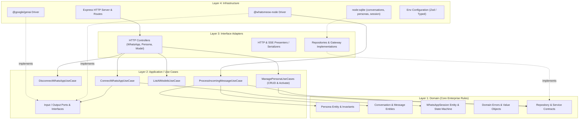
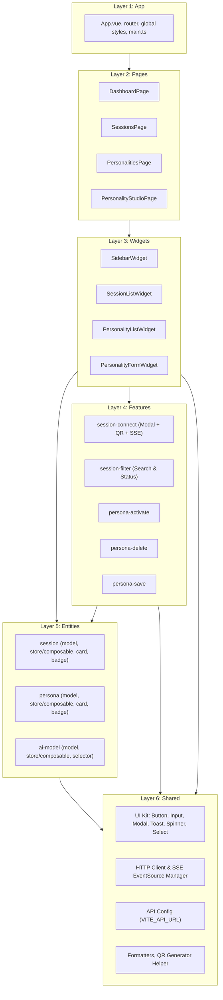
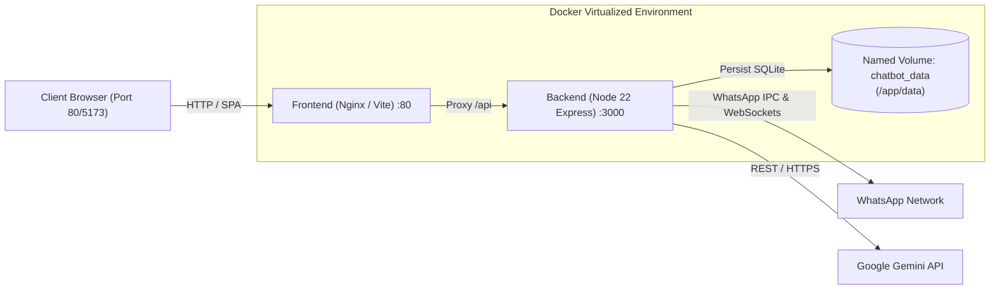
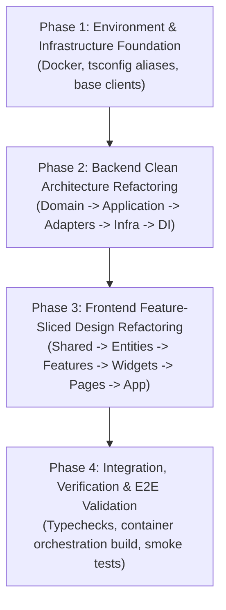

# FusionChatbot: Complete Refactoring Blueprint
## Clean Architecture (Backend) & Feature-Sliced Design (Frontend)

---

## 1. Executive Summary & Codebase Diagnosis

An exhaustive architectural audit of the current **FusionChatbot** fullstack codebase was conducted. The application consists of a **Node.js 22 (Express + SQLite + Whatsmeow + Gemini)** backend and a **Vue 3 (Vite + Tailwind CSS + Vue Router)** frontend.

### 1.1 Backend Audit & Pain Points
1. **Framework & Driver Tight Coupling**:
   - [`Backend/src/bootstrap/main.ts`](file:///home/antonio/proyectos/ChatBotWhatsappNode/Backend/src/bootstrap/main.ts) acts as a monolithic composition point tightly coupling Express HTTP server creation, CORS setup, WhatsApp connection instantiation, message listener attachments, and process shutdown.
   - [`Backend/src/api/routes.ts`](file:///home/antonio/proyectos/ChatBotWhatsappNode/Backend/src/api/routes.ts) combines route declaration, HTTP payload parsing, request validation (`personaInput`), business logic / slugification (`slugify`), error-to-status code translation, and direct calls to infrastructure classes (`DatabasePersonaManager`, `WhatsAppConnection`, and `listAvailableModels`).
2. **Violation of the Single Responsibility Principle (SRP)**:
   - [`Chatbot`](file:///home/antonio/proyectos/ChatBotWhatsappNode/Backend/src/chat/chatbot.ts) functions simultaneously as an incoming message dispatcher, concurrency queue serializer, mark-as-read executor, conversation history loader, AI prompt invoker, chunk splitter, WhatsApp sender, and persistence writer.
   - [`PersonaDatabase`](file:///home/antonio/proyectos/ChatBotWhatsappNode/Backend/src/persona/persona-database.ts) mixes DDL execution, schema migration, JSON legacy file migration, CRUD database queries, active persona logic, and domain serialization.
3. **Absence of Domain Layer & Abstraction Inversion**:
   - Business entities do not exist as independent domain models with self-contained validation and invariants. Data structures are passed around as raw records or utility interfaces (`PersonaRecord`, `PersonaInput`, `ConversationMessage`).
   - Core application logic directly depends on low-level infrastructure drivers: `node:sqlite` (`DatabaseSync`), `@whatsmeow-node/whatsmeow-node`, and `@google/genai`. Inversion of Control (DIP) is absent.

### 1.2 Frontend Audit & Pain Points
1. **Flat, Monolithic Views**:
   - [`SessionsView.vue`](file:///home/antonio/proyectos/ChatBotWhatsappNode/Frontend/src/views/SessionsView.vue) (374 lines) manages SSE lifecycle, QR code generation (`QRCode.toDataURL`), local timer state, modal state, filter state, and direct HTTP calls.
   - [`PersonalityStudioView.vue`](file:///home/antonio/proyectos/ChatBotWhatsappNode/Frontend/src/views/PersonalityStudioView.vue) (436 lines) handles form state, slider bindings, model fetching, persona selection, and persistence.
2. **Scattered State & Mixed Concerns**:
   - No reactive centralized domain store (e.g. Pinia or domain-scoped composables). State is managed via local `ref()` instances inside views. If a sidebar or dashboard needs the active persona or WhatsApp status, it must duplicate fetch logic.
   - [`services/api.ts`](file:///home/antonio/proyectos/ChatBotWhatsappNode/Frontend/src/services/api.ts) couples raw HTTP fetch calls, data transformation (`toSession`), and EventSource stream handling in one un-scoped file.
3. **Lack of Component Hierarchy**:
   - Reusable UI primitives (`Button`, `Input`, `Modal`) are mixed with domain components (`SessionCard`, `SessionList`) without clear architectural boundaries or adherence to modular frontend paradigms like Feature-Sliced Design (FSD).

### 1.3 Environment & Deployment Audit
- The project lacks containerization assets (`Dockerfile`, `docker-compose.yml`, `.dockerignore`).
- The backend relies on Node >= 22.5.0 for built-in `node:sqlite` (`DatabaseSync`) and native Go IPC binaries from `@whatsmeow-node/whatsmeow-node`.
- SQLite data persistence (`data/session.db`, `data/conversations.db`, `data/personalidades.db`) requires explicit container volume management and graceful shutdown to prevent SQLite WAL corruption.

---

## 2. Backend Clean Architecture Design (Node.js)

Clean Architecture enforces the **Dependency Rule**: *Source code dependencies must point only inward, toward higher-level policies.*



### 2.1 Layer Breakdown & Responsibilities

#### 1. Domain Layer (`src/domain/`)
- **Zero external dependencies**: Contains only pure TypeScript. Independent of Express, SQLite, Google GenAI, and Whatsmeow.
- **Entities & Value Objects**:
  - `Persona`: Validates invariants (non-empty name, prompt structure, model string, valid generation config bounds like temperature `0.0..2.0`, topP `0.0..1.0`, thinking level enum).
  - `Conversation`: Manages conversation history, exchange appending (`user` + `model`), max history enforcement, and message normalization.
  - `Message`: Immutable value object with role (`user` | `model`), content text, and timestamp.
  - `WhatsAppSession`: State machine for connection lifecycle (`idle`, `connecting`, `awaiting_qr`, `connected`, `disconnected`, `logged_out`), JID, and QR payload.
- **Domain Errors**:
  - `EntityNotFoundError`, `ValidationError`, `DomainConflictError`, `ExternalServiceError`.
- **Contracts (Ports)**:
  - `IPersonaRepository`: `findById(id)`, `findAll()`, `save(persona)`, `delete(id)`, `getActive()`, `setActive(id)`.
  - `IConversationRepository`: `load(conversationId, limit)`, `appendExchange(conversationId, userMsg, modelMsg)`, `clear(conversationId)`, `clearAll()`.
  - `IAIService`: `generateContent(prompt, history, personaConfig)`, `listAvailableModels()`.
  - `IWhatsAppGateway`: `connect()`, `disconnect()`, `logout()`, `getStatus()`, `sendMessage(jid, text)`, `markAsRead(id, chat, sender)`, `onEvent(listener)`.

#### 2. Use Cases / Application Layer (`src/application/`)
- Contains application-specific business logic. Coordinates domain entities and invokes repository/gateway interfaces.
- **Use Cases**:
  - `ConnectWhatsAppUseCase`: Initiates connection, manages idempotent connection promises, broadcasts state changes.
  - `DisconnectWhatsAppUseCase` & `LogoutWhatsAppUseCase`: Handles session teardown and credentials revocation.
  - `GetWhatsAppStatusUseCase`: Returns current session snapshot.
  - `ProcessIncomingMessageUseCase`:
    - Filters out self-messages and non-text messages.
    - Resolves conversational keys (`group:sender` vs. direct `chat`).
    - Serializes message queues per conversation to prevent race conditions.
    - Marks message as read.
    - Loads active persona & historical context.
    - Generates response via `IAIService`.
    - Chunks response via text splitter rules.
    - Sends split messages with natural delay spacing.
    - Persists exchange to `IConversationRepository`.
  - `ListPersonasUseCase`, `GetPersonaUseCase`, `CreatePersonaUseCase`, `UpdatePersonaUseCase`, `DeletePersonaUseCase`, `ActivatePersonaUseCase`.
  - `ListAIModelsUseCase`.
- **DTOs**:
  - Explicit input command schemas and read-only output view models.

#### 3. Adapters Layer (`src/adapters/`)
- Translates data between the format most convenient for use cases and entities, and the format external agents (web, database, CLI) require.
- **Controllers**:
  - `WhatsAppController`: Handles `connect`, `disconnect`, `logout`, `status`, `events` (SSE).
  - `PersonaController`: Handles persona CRUD and activation endpoints.
  - `AIModelController`: Handles model listing.
- **Presenters**:
  - Format output payloads, translate domain errors into HTTP status codes (400, 404, 409, 500), manage SSE chunk formatting (`text/event-stream`).
- **Gateways & Repositories (Implementations)**:
  - `SqlitePersonaRepository`: Implements `IPersonaRepository` using the SQLite driver.
  - `SqliteConversationRepository`: Implements `IConversationRepository`.
  - `WhatsmeowGateway`: Implements `IWhatsAppGateway`.
  - `GeminiAIGateway`: Implements `IAIService`.

#### 4. Infrastructure Layer (`src/infrastructure/`)
- The outermost layer with frameworks and tools.
- **HTTP / Web Server**: Express app setup, CORS, router mounting, global error middleware.
- **Database & Storage**: `node:sqlite` connection management, WAL mode activation, table DDL, JSON migration scripts.
- **Configuration**: Strongly-typed environment parser (`config.ts`).
- **Composition Root / Container**: `container.ts` orchestrates pure Dependency Injection (IoC), wiring drivers to repositories, repositories to use cases, and use cases to controllers.

---

### 2.2 Proposed Backend Directory Tree

```text
Backend/
├── data/                                 # Persistent SQLite databases (mounted in Docker)
│   ├── conversations.db
│   ├── personalidades.db
│   └── session.db
├── src/
│   ├── domain/                           # Layer 1: Core Enterprise Business Rules
│   │   ├── entities/
│   │   │   ├── persona.entity.ts
│   │   │   ├── conversation.entity.ts
│   │   │   ├── message.value-object.ts
│   │   │   └── whatsapp-session.entity.ts
│   │   ├── errors/
│   │   │   ├── domain.error.ts
│   │   │   ├── not-found.error.ts
│   │   │   ├── validation.error.ts
│   │   │   └── conflict.error.ts
│   │   └── repositories/
│   │       ├── persona.repository.interface.ts
│   │       ├── conversation.repository.interface.ts
│   │       ├── ai.service.interface.ts
│   │       └── whatsapp.gateway.interface.ts
│   │
│   ├── application/                      # Layer 2: Application Business Rules (Use Cases)
│   │   ├── dtos/
│   │   │   ├── persona.dto.ts
│   │   │   ├── whatsapp.dto.ts
│   │   │   └── ai-model.dto.ts
│   │   └── use-cases/
│   │       ├── whatsapp/
│   │       │   ├── connect-whatsapp.use-case.ts
│   │       │   ├── disconnect-whatsapp.use-case.ts
│   │       │   ├── logout-whatsapp.use-case.ts
│   │       │   ├── get-whatsapp-status.use-case.ts
│   │       │   └── process-incoming-message.use-case.ts
│   │       ├── persona/
│   │       │   ├── list-personas.use-case.ts
│   │       │   ├── get-persona.use-case.ts
│   │       │   ├── create-persona.use-case.ts
│   │       │   ├── update-persona.use-case.ts
│   │       │   ├── delete-persona.use-case.ts
│   │       │   └── activate-persona.use-case.ts
│   │       └── ai-model/
│   │           └── list-ai-models.use-case.ts
│   │
│   ├── adapters/                         # Layer 3: Interface Adapters
│   │   ├── controllers/
│   │   │   ├── whatsapp.controller.ts
│   │   │   ├── persona.controller.ts
│   │   │   └── ai-model.controller.ts
│   │   ├── presenters/
│   │   │   ├── http.presenter.ts
│   │   │   └── sse.presenter.ts
│   │   └── gateways/
│   │       ├── repositories/
│   │       │   ├── sqlite-persona.repository.ts
│   │       │   └── sqlite-conversation.repository.ts
│   │       ├── external/
│   │       │   ├── gemini-ai.gateway.ts
│   │       │   └── whatsmeow.gateway.ts
│   │       └── utils/
│   │           ├── message-splitter.ts
│   │           └── conversation-key.ts
│   │
│   ├── infrastructure/                   # Layer 4: Frameworks & Drivers
│   │   ├── config/
│   │   │   └── env.config.ts
│   │   ├── database/
│   │   │   ├── sqlite-connection.ts
│   │   │   └── migrations/
│   │   │       ├── schema.init.ts
│   │   │       └── legacy-json.migration.ts
│   │   ├── http/
│   │   │   ├── express-app.ts
│   │   │   ├── middlewares/
│   │   │   │   ├── cors.middleware.ts
│   │   │   │   └── error.middleware.ts
│   │   │   └── routes/
│   │   │       ├── whatsapp.routes.ts
│   │   │       ├── persona.routes.ts
│   │   │       ├── ai-model.routes.ts
│   │   │       └── index.ts
│   │   └── di/
│   │       └── container.ts              # Pure Dependency Injection Composition Root
│   │
│   └── main.ts                           # Process Entry Point & Lifecycle Bootstrap
├── package.json
├── tsconfig.json
└── README.md
```

---

## 3. Frontend Feature-Sliced Design (Vue.js)

Feature-Sliced Design (FSD) provides strict architectural rules for frontends, dividing code into standard layers with unidirectional dependencies (an element in a layer can only import from lower layers).



### 3.1 Layer Breakdown & Responsibilities

1. **`app/` (Application Layer)**:
   - Initializes router, global providers, and Tailwind styles. Contains root component [`App.vue`](file:///home/antonio/proyectos/ChatBotWhatsappNode/Frontend/src/App.vue).
2. **`pages/` (Views / Routes)**:
   - Pure compositional views mapped 1:1 to routes. No direct low-level API calls. Pages assemble widgets and features.
   - `dashboard/`, `sessions/`, `personalities/`, `personality-studio/`.
3. **`widgets/` (Composite UI Blocks)**:
   - Self-contained, multi-component sections of the screen:
     - `sidebar/`: Complete navigation sidebar.
     - `session-list/`: Grid/list of session cards with empty state handler.
     - `personality-studio/`: Prompt engineering split panel (editor + parameters).
4. **`features/` (User Interactions & Workflows)**:
   - User actions with tangible business value:
     - `session-connect/`: Opens connection modal, opens SSE stream, turns QR string into image via client utility, auto-closes on connected.
     - `session-filter/`: Search bar and status dropdown that filters sessions.
     - `persona-activate/`: Action button triggering activation and updating UI state.
     - `persona-delete/`: Safe delete workflow preventing active persona deletion.
5. **`entities/` (Business Entities)**:
   - Contains domain concepts with their own types, reactive state composables (`useSessionStore`, `usePersonaStore`), API clients, and presentation components (`SessionCard.vue`, `SessionStatusBadge.vue`):
     - `session/`: Model, API endpoints (`/api/whatsapp/*`), composable `useSession.ts`.
     - `persona/`: Model, API endpoints (`/api/personas/*`), composable `usePersona.ts`.
     - `ai-model/`: Model, API endpoints (`/api/models`), composable `useAIModel.ts`.
6. **`shared/` (Reusable Infrastructure & Primitives)**:
   - Generic code independent of business domain:
     - `ui/`: Completely 'dumb' presentational components: `Button.vue`, `Input.vue`, `Textarea.vue`, `Modal.vue`, `NoticeToast.vue`, `Select.vue`, `Spinner.vue`.
     - `api/`: Centralized HTTP fetch wrapper (`fetchClient.ts`) and SSE manager (`sseClient.ts`).
     - `config/`: Environment configuration (`env.ts`).
     - `lib/`: Utilities (`qrcode.ts`, `slugify.ts`).

---

### 3.2 Proposed Frontend Directory Tree

```text
Frontend/
├── src/
│   ├── app/                              # Application Initialization Layer
│   │   ├── router/
│   │   │   └── index.ts
│   │   ├── styles/
│   │   │   └── main.css
│   │   ├── App.vue
│   │   └── main.ts
│   │
│   ├── pages/                            # Route Pages Layer
│   │   ├── dashboard/
│   │   │   └── ui/DashboardPage.vue
│   │   ├── sessions/
│   │   │   └── ui/SessionsPage.vue
│   │   ├── personalities/
│   │   │   └── ui/PersonalitiesPage.vue
│   │   └── personality-studio/
│   │       └── ui/PersonalityStudioPage.vue
│   │
│   ├── widgets/                          # Complex UI Blocks Layer
│   │   ├── sidebar/
│   │   │   └── ui/
│   │   │       ├── SidebarWidget.vue
│   │   │       └── NavItem.vue
│   │   ├── session-list/
│   │   │   └── ui/SessionListWidget.vue
│   │   ├── personality-list/
│   │   │   └── ui/PersonalityListWidget.vue
│   │   └── personality-studio/
│   │       └── ui/
│   │           ├── StudioHeader.vue
│   │           ├── PromptEditorPane.vue
│   │           └── ParameterControlsPane.vue
│   │
│   ├── features/                         # User Interaction Features Layer
│   │   ├── session-connect/
│   │   │   ├── model/
│   │   │   │   └── useSessionConnect.ts
│   │   │   └── ui/ConnectSessionModal.vue
│   │   ├── session-filter/
│   │   │   └── ui/SessionFilterBar.vue
│   │   ├── persona-activate/
│   │   │   └── ui/ActivatePersonaButton.vue
│   │   ├── persona-delete/
│   │   │   └── ui/DeletePersonaModal.vue
│   │   └── persona-save/
│   │       └── model/useSavePersona.ts
│   │
│   ├── entities/                         # Business Domain Entities Layer
│   │   ├── session/
│   │   │   ├── api/session.api.ts
│   │   │   ├── model/
│   │   │   │   ├── types.ts
│   │   │   │   └── useSessionStore.ts
│   │   │   └── ui/
│   │   │       ├── SessionCard.vue
│   │   │       └── SessionStatusBadge.vue
│   │   ├── persona/
│   │   │   ├── api/persona.api.ts
│   │   │   ├── model/
│   │   │   │   ├── types.ts
│   │   │   │   └── usePersonaStore.ts
│   │   │   └── ui/
│   │   │       └── PersonaCard.vue
│   │   └── ai-model/
│   │       ├── api/ai-model.api.ts
│   │       ├── model/
│   │       │   ├── types.ts
│   │       │   └── useAIModelStore.ts
│   │       └── ui/ModelSelector.vue
│   │
│   └── shared/                           # Shared / Low-Level Kit Layer
│       ├── api/
│       │   ├── http-client.ts
│       │   └── sse-client.ts
│       ├── config/
│       │   └── env.ts
│       ├── lib/
│       │   ├── qrcode.ts
│       │   └── formatters.ts
│       └── ui/
│           ├── Button.vue
│           ├── Input.vue
│           ├── Textarea.vue
│           ├── Select.vue
│           ├── Modal.vue
│           ├── NoticeToast.vue
│           └── Spinner.vue
│
├── index.html
├── package.json
├── tsconfig.json
├── vite.config.ts
└── README.md
```

---

## 4. Environments & Cloud Deployment Architecture

To ensure container parity across development, staging, and production, and to optimize for cloud deployments (AWS ECS, Google Cloud Run with Volume, Azure Container Apps, or Docker Swarm/Compose):

### 4.1 Root Structure & Docker Assets

```text
ChatBotWhatsappNode/
├── .dockerignore
├── docker-compose.yml                    # Local & Staging orchestration
├── docker-compose.prod.yml               # Production overrides
├── Backend/
│   ├── Dockerfile
│   └── .dockerignore
├── Frontend/
│   ├── Dockerfile
│   ├── nginx.conf                        # Production Nginx reverse-proxy / SPA router
│   └── .dockerignore
└── README.md
```

### 4.2 Backend Container Design
- **Base Image**: `node:22-bookworm-slim`
  - *Rationale*: Debian Bookworm Slim includes the standard glibc libraries required by `@whatsmeow-node`'s subprocess IPC architecture, guaranteeing compatibility with native binary architectures (`linux-x64` / `linux-arm64`). It avoids musl DNS/Go threading issues encountered in Alpine while keeping the final image lightweight (<250MB).
- **Node Engine**: Node 22.5.0+ guarantees native `node:sqlite` availability without external C++ compilation (`node-gyp`).
- **Volume Mounts**: `/app/data` is mounted to a named Docker volume (`chatbot_data`) to ensure SQLite databases (`session.db`, `conversations.db`, `personalidades.db`) persist across container restarts and updates.
- **Graceful Shutdown**: The Node process registers `SIGTERM` and `SIGINT` to close the WhatsApp connection, flush SQLite WAL journals, and close HTTP listeners cleanly.
- **Health Check**: Native `GET /health` responding with 200 OK.

### 4.3 Frontend Container Design
- **Multi-Stage Build**:
  - **Stage 1 (Builder)**: `node:22-alpine` runs `npm ci` and `npm run build`, producing an optimized static bundle in `/app/dist`.
  - **Stage 2 (Server)**: `nginx:alpine` copies the build output into `/usr/share/nginx/html`.
- **Nginx Configuration (`nginx.conf`)**:
  - Handles client-side routing via `try_files $uri $uri/ /index.html`.
  - Proxies `/api/` requests directly to the `backend` service container on port 3000, eliminating CORS friction in containerized environments.
  - Properly configures SSE streaming headers (`proxy_buffering off`, `proxy_cache off`, `proxy_read_timeout 86400s`) so `/api/whatsapp/events` stream frames are delivered immediately without buffering.

### 4.4 Docker Compose Architecture



---

## 5. Justification of Design Patterns & Principles

| Pattern / Principle | Applied Layer / Component | Rationale & Practical Benefit |
|---|---|---|
| **Dependency Inversion Principle (DIP)** | Backend (Domain ↔ Adapters) | High-level use cases depend on abstract repository/service interfaces (`IPersonaRepository`, `IAIService`, `IWhatsAppGateway`). Infrastructure drivers (`node:sqlite`, `@google/genai`, `@whatsmeow-node`) implement these interfaces. Changing the DB (e.g. to PostgreSQL) or AI provider (e.g. to Claude/OpenAI) will require zero modifications to use cases or business rules. |
| **Pure Dependency Injection (IoC Container)** | Backend (`infrastructure/di/container.ts`) | Eliminates hardcoded `new Service()` instantiations inside controllers or use cases. All dependencies are injected at the composition root, making every class 100% unit-testable with mock objects. |
| **Single Responsibility Principle (SRP)** | Backend & Frontend | Replaces the monolithic `Chatbot` and `SessionsView` with focused interactors (`ProcessIncomingMessageUseCase`, `ConnectWhatsAppUseCase`, `useSessionConnect`). Each class or module has exactly one reason to change. |
| **Command / Query Responsibility Separation (CQRS light)** | Backend Use Cases | Separates write/mutation use cases (`CreatePersona`, `ActivatePersona`, `ConnectWhatsApp`) from query use cases (`ListPersonas`, `GetWhatsAppStatus`), keeping data access optimal and logic isolated. |
| **Feature-Sliced Design (FSD)** | Frontend (`src/`) | Provides predictable code organization with strict unidirectional imports. Prevents circular dependencies, isolates features into modular slices, and allows teams to scale frontend features without regression risks. |
| **State Management via Domain Composables** | Frontend Entities (`useSessionStore`, `usePersonaStore`) | Provides reactive, shared state across views and widgets without relying on massive global state boilerplate, keeping reactivity closely tied to domain entities. |
| **Multi-Stage Containerization** | DevOps / Docker | Produces ultra-compact production images without build dependencies (`node_modules` dev dependencies, TypeScript compiler). Separates frontend static delivery (Nginx) from backend execution. |

---

## 6. Phased Refactoring Execution Plan

Upon user approval, refactoring will execute systematically across four safe phases:



### Phase 1: Foundation & DevOps Setup
- Setup path aliases in `tsconfig.json` for both Backend (`@domain/*`, `@application/*`, `@adapters/*`, `@infrastructure/*`) and Frontend (`@app/*`, `@pages/*`, `@widgets/*`, `@features/*`, `@entities/*`, `@shared/*`).
- Create `Dockerfile` (Backend), `Dockerfile` + `nginx.conf` (Frontend), and `docker-compose.yml`.

### Phase 2: Backend Clean Architecture
- **Step 2.1**: Implement `Domain` entities, value objects, domain errors, and interface contracts.
- **Step 2.2**: Implement `Application` use cases and DTOs.
- **Step 2.3**: Implement `Adapters`: SQLite repositories, Gemini AI gateway, Whatsmeow gateway, message splitter/key utilities, controllers, and presenters.
- **Step 2.4**: Implement `Infrastructure`: Express app, routes, middleware, and pure DI `container.ts`.
- **Step 2.5**: Update `main.ts` entry point and verify complete TypeScript compilation (`npm run typecheck`).

### Phase 3: Frontend Feature-Sliced Design
- **Step 3.1**: Refactor `shared/` layer (UI kit primitives, HTTP/SSE clients, utilities).
- **Step 3.2**: Refactor `entities/` layer (`session`, `persona`, `ai-model` models, stores, and presentation cards).
- **Step 3.3**: Refactor `features/` layer (`session-connect`, `session-filter`, `persona-activate`, `persona-delete`, etc.).
- **Step 3.4**: Refactor `widgets/` layer (`sidebar`, `session-list`, `personality-studio`).
- **Step 3.5**: Refactor `pages/` and `app/` layers.
- **Step 3.6**: Verify complete TypeScript compilation and Vite build (`npm run build`).

### Phase 4: Verification & Handover
- Execute type checks on both projects.
- Validate backward compatibility of SQLite data and environment variables.
- Deliver comprehensive documentation on the new architecture and container workflow.
